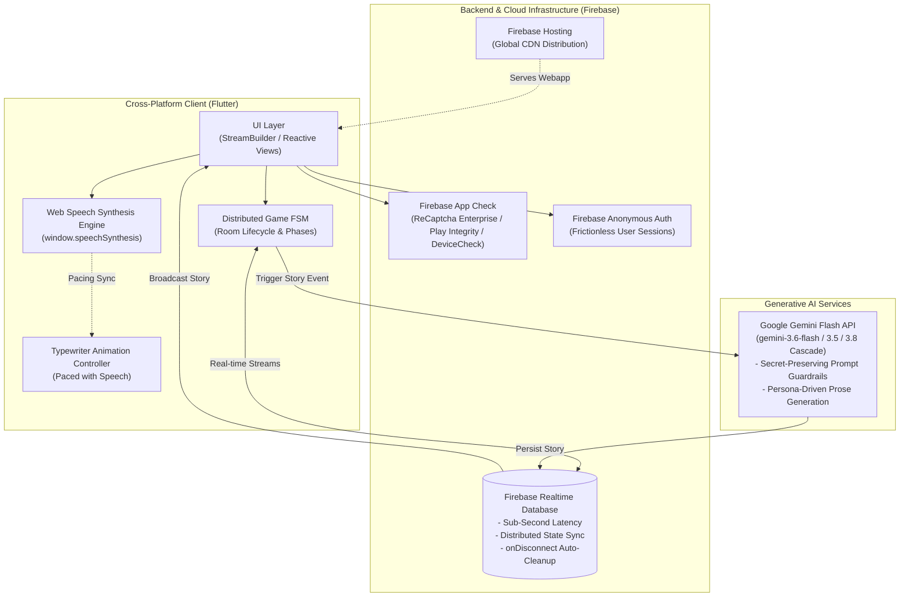
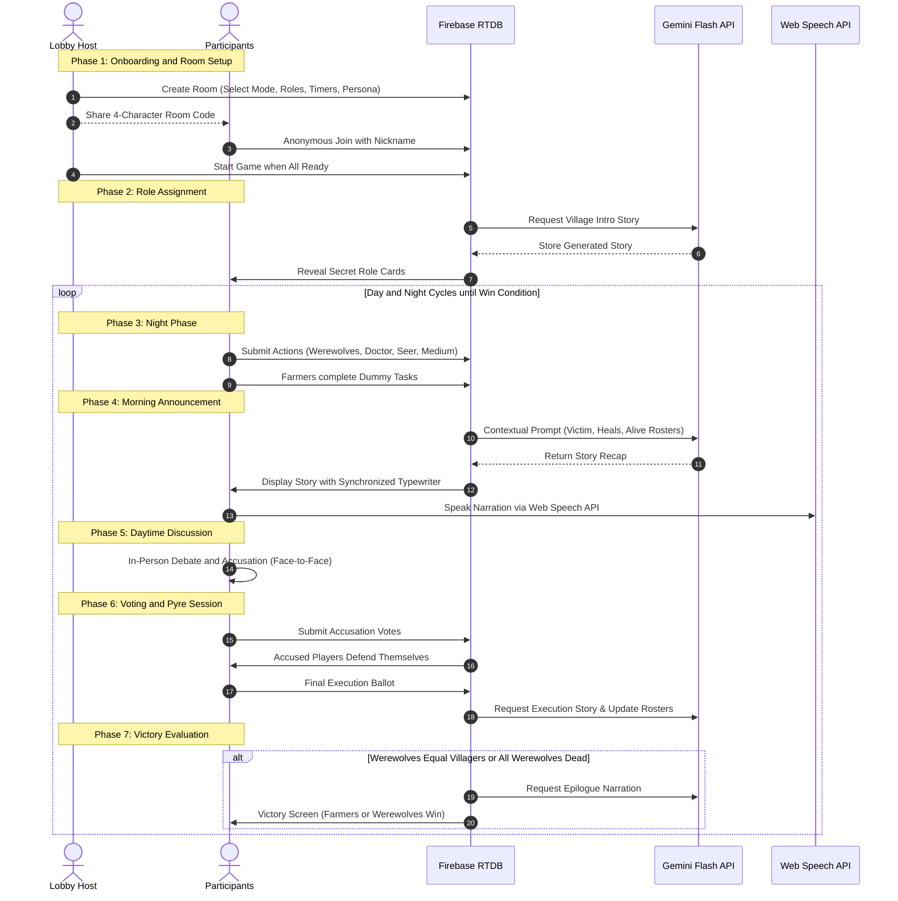

# LLMs in Fabula
> **An AI-Orchestrated, Multiplatform Social Deduction Game for Face-to-Face Tabletop Play**

---

## Executive Summary

**LLMs in Fabula** transforms the classic social deduction game *Lupus in Fabula* (Mafia / Werewolf) into a hybrid physical-digital tabletop experience. By substituting the traditional human game master with an autonomous **Generative AI Narrator** paired with **Client-Side Text-to-Speech (TTS)**, the application delivers reactive, context-aware storytelling while preserving the core essence of face-to-face party gaming.

Unlike online deduction platforms that isolate players behind voice chat and digital avatars, **LLMs in Fabula intentionally omits online voice and text chat**. The mobile and web interfaces act purely as silent coordinators: managing secret night actions, enforcing game rules, and resolving state transitions, while focusing all player attention on in-person debate, persuasion, and social interaction.

---

## System Architecture

The application is built on a **reactive, event-driven architecture** centered around a distributed Finite State Machine (FSM) synchronized in real-time across connected clients via Firebase Realtime Database.

### 1. Frontend and Client Layer (Flutter / Dart)
* **Single Codebase Multiplatform**: Fully optimized for Web browsers, Android, iOS, and macOS.
* **State Management and Reactivity**: Employs reactive `StreamBuilder` pipelines connected to Firebase Realtime Database references (`rooms/{roomId}`), eliminating manual polling and keeping all client screens in lockstep.
* **Typewriter and Speech Synchronization**: Custom animation controllers render narrated stories character-by-character at speech-like cadence, paired with live audio speech playback and user mute toggles.

### 2. Realtime Synchronization and Infrastructure (Firebase)
* **Low-Latency Distributed State**: Manages state transitions across all phases (Night, Morning Recap, Discussion, Voting, Pyre Session, Victory) with millisecond synchronization.
* **Resilient Room Lifecycle**: Uses `onDisconnect` database handlers to clean up abandoned rooms and notify remaining players immediately if the room host leaves.
* **Frictionless Anonymous Authentication**: Authenticates users anonymously via Firebase Auth upon opening the app, eliminating sign-up forms, passwords, and user tracking.
* **App Protection**: Enforces **Firebase App Check** with ReCaptcha Enterprise on Web, Play Integrity on Android, and DeviceCheck on Apple platforms to safeguard database endpoints from unauthorized abuse.

### 3. Generative Narrative Engine (Google Gemini Flash)
* **Contextual Prompting**: Builds narrative prompts dynamically from live game data: player rosters, faction counts, night actions (attacks, protects, investigations), and daily executions.
* **Role and Secrecy Guardrails**: System instructions strictly prevent game spoilers:
  * Identities of living and dead players remain confidential until final game resolution.
  * Night investigations and protections are never disclosed in public stories.
  * Word limits (40–60 words) keep storytelling concise and maintain fast-paced in-person gameplay.
* **Multi-Model Fallback Cascade**: Implements automatic runtime failover across candidate Gemini models (`gemini-3.6-flash` -> `gemini-3.5-flash` -> `gemini-3.8-flash`) to ensure continuous gameplay without interruption.

### 4. Client-Side Text-to-Speech (Web Speech API)
* **Zero-Cost Scalable Speech**: Leverages the browser-native Web Speech Synthesis API (`window.speechSynthesis`).
* **Persona-Driven Modulation**: Dynamically selects available system voices based on narrator persona, tuning pitch, speech rate, and intonation for each storytelling style.
* **Playback Resilience**: Incorporates an automated keepalive timer to prevent browser synthesis pauses during extended narrations.

---

## Game Modes and Modalities

### 1. Standard Mode (Autonomous AI Narrator)
The AI acts as an impartial storyteller. Room creators can configure the narrator with one of **4 distinct Narrator Personas**, altering prose tone and speech modulation:

| Persona | Voice Tone | Narration Style |
| :--- | :--- | :--- |
| **Bard Storyteller** | Charismatic, energetic tenor | Warm, theatrical, and descriptive medieval storytelling. |
| **Dark Wizard** | Low pitch, deliberate cadence | Eerie, gothic presence, speaking in cryptic whispers. |
| **The Oracle** | Elevated pitch, measured pace | Mystical prophecies, slow rhythmic delivery, and solemn prophecies. |
| **Old Folk** | Earthy, rustic baritone | Direct, nostalgic village elder recounting personal memory and folklore. |

### 2. Classic Mode (Human Narrator Dashboard)
For groups that prefer an in-person human moderator, Classic Mode converts the application into an **interactive Narrator Dashboard**:
* Removes the need for physical role cards, pen-and-paper notes, or secret hand-gesturing.
* The elected human narrator receives a private real-time HUD displaying all night actions (wolf targets, doctor protections, seer investigations).
* Provides structured on-screen cues to assist the narrator in guiding players through day and night cycles verbally.

### 3. Spectator Mode
A dedicated observer screen designed for teachers, facilitators, or event organizers:
* Provides full real-time visibility into role distributions, living and eliminated players, and voting ballots.
* Enables group moderation and social observation without participating in or influencing game outcomes.

---

## Roles and Fair Play Mechanics

| Role | Faction | Night Action | Description |
| :--- | :--- | :--- | :--- |
| **Werewolf** | Werewolves | Secret Vote | Coordinates in secret with other werewolves to eliminate one villager each night. |
| **Doctor** | Villagers | Protect | Selects one player per night to shield from werewolf attacks. |
| **Seer** | Villagers | Inspect | Scans one player per night to discover whether they are a Villager or a Werewolf. |
| **Medium** | Villagers | Commune | Consults the spirits to discover if the previously executed player was guilty or innocent. |
| **Farmer** | Villagers | Dummy Tasks | Regular villager with no active power; participates in night micro-tasks to mask special roles. |
| **Spectator** | Neutral | None | Observes game state without participating. |

### The "Dummy Tasks" Anti-Peeking Mechanic
In physical deduction games assisted by personal mobile devices, players can often deduce active roles simply by noticing who is tapping their phone screen during the night phase while passive villagers sit idle.

**LLMs in Fabula eliminates this vulnerability through Dummy Tasks**:
During every night phase, Farmers receive randomized micro-tasks on their screens (*"Drink fresh milk"*, *"Count sheep"*, *"Feed the chickens"*, *"Look at the stars"*). Because all players interact with their screens simultaneously, physical movement and screen light cannot reveal who holds an active role.

---

## User Flow and Experience (UX)

### UX Design Details
* **Zero Onboarding Friction**: No account creation, passwords, or email verification required; players enter a 4-character room code and their nickname.
* **Atmospheric Theme**: Dark nocturnal interface palette (`#022F40`), custom serif typography (`Risque` via Google Fonts), and responsive vector assets.
* **Role Guide Drawer**: An in-game guide drawer (`RoleRulesDrawer`) is accessible from every phase, allowing players to verify role abilities and win conditions at any time without tipping off opponents.
* **Configurable Timers**: Flexible countdown durations for night decisions, daytime debates, and voting sessions keep games structured and fast-paced.

---

## Tech Stack and Dependencies

| Layer | Technology | Purpose |
| :--- | :--- | :--- |
| **Client Framework** | [Flutter](https://flutter.dev) (v3.9+) | Cross-platform UI toolkit targeting Web, Android, iOS, macOS |
| **Language** | [Dart](https://dart.dev) (v3.9+) | Null-safe language for all application logic |
| **Realtime Database** | [Firebase Realtime Database](https://firebase.google.com/docs/database) | Low-latency distributed state machine across all devices |
| **Authentication** | [Firebase Auth](https://firebase.google.com/docs/auth) | Anonymous user authentication for immediate access |
| **Security** | [Firebase App Check](https://firebase.google.com/docs/app-check) | ReCaptcha Enterprise on Web and Play Integrity on Android |
| **Generative LLM** | [Google Gemini Flash API](https://ai.google.dev) | Real-time narrative recap generation with model fallback cascade |
| **Speech Synthesis** | Web Speech API (`window.speechSynthesis`) | Client-side text-to-speech with persona-tuned pitch and speech rate |
| **Typography and Icons** | `google_fonts`, `flutter_svg` | Custom typography and scalable role iconography |
| **Hosting** | [Firebase Hosting](https://firebase.google.com/docs/hosting) | Production web deployment on Google Cloud infrastructure |

---

## Live Application and How to Play

The application is deployed and hosted on Firebase Hosting with zero installation required. You can play directly in any modern desktop, tablet, or mobile browser:

**Live Web App**: [https://llminfabula-1.web.app/](https://llminfabula-1.web.app/)

### How to Play

1. **Open the Web App**: Navigate to [llminfabula-1.web.app](https://llminfabula-1.web.app/) on any browser.
2. **Create or Join a Room**:
   * **Host**: Tap **Create Room**, enter your nickname, select a game mode (*Standard AI Narrator* or *Classic Mode*), choose a narrator persona, set turn timers, and generate a 4-character room code.
   * **Players**: Tap **Join Room**, enter your nickname and the 4-character room code shared by the host.
3. **Lobby and Ready Check**: Once all players have joined the lobby and toggled **Ready**, the host starts the game.
4. **Gameplay**: Devices silently coordinate secret night actions and morning recaps with audio narration, while players debate and vote face-to-face in the same physical space.

---

## Academic Origins and Ongoing Development

This project was initially conceived and developed as an academic group project for the **Advanced User Interfaces** course at **Politecnico di Milano (Polimi)**.

Following the conclusion of the university coursework, [Vincenzo Picone](https://github.com/vincenzopiconee) continued the development, engineering, and architectural scaling of the project independently to transform it into a full production-ready web application:
* **Web Platform Migration and Architecture**: Re-engineered the application for web deployment, ensuring smooth cross-device accessibility directly from any mobile or desktop browser without installation.
* **Client-Side Web Speech TTS**: Migrated the speech synthesis pipeline to the browser's native Web Speech API (`window.speechSynthesis`), developing voice matching heuristics and keepalive routines for zero-cost, infinite scalability.
* **Classic Game Modality**: Designed and built Classic Mode, introducing a dedicated digital Narrator Dashboard for human moderators.
* **Resilience and AI Pipeline**: Integrated Gemini Flash multi-model fallback cascades, App Check security, and robust room cleanup handling.
* **Large-Scale Testing**: Conducted extensive testing and optimizations on state sync payloads and concurrency.

---

## Collaborators

The initial academic prototype was developed in collaboration with:

* [Filippo Galletta](https://github.com/filippogalletta)
* [Niccolo Sobrero](https://github.com/niccolosobrero)
* [Alessia Beatrice Viani](https://github.com/alessiabeatriceviani)

*(Politecnico di Milano — Advanced User Interfaces course)*

---

## License

This project is licensed under the MIT License — see the [LICENSE](LICENSE) file for details.
